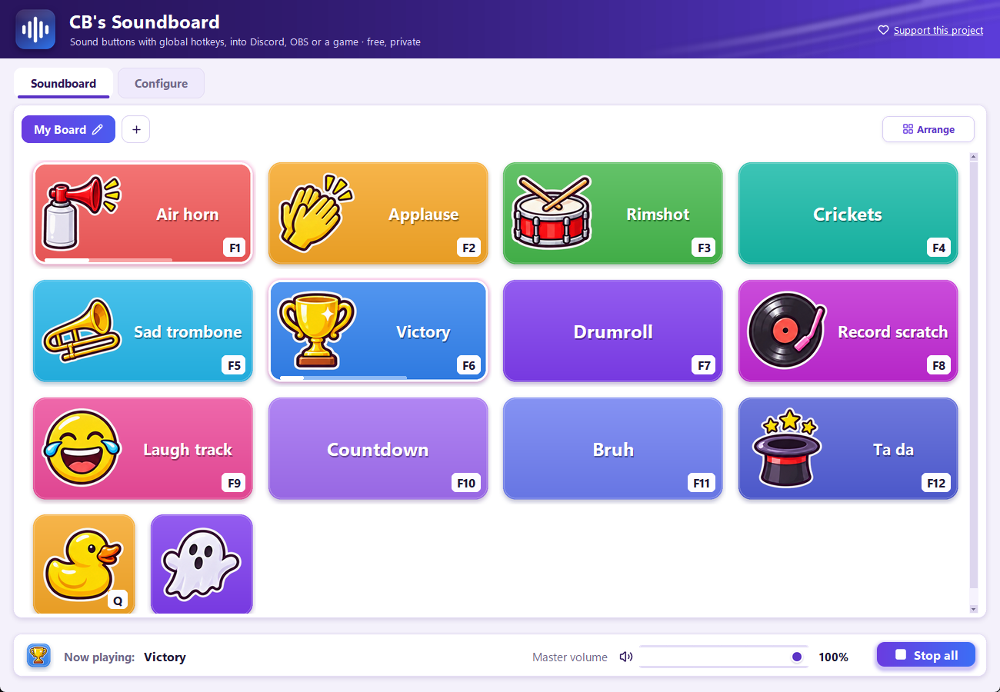

# CB's Soundboard

**Free, offline soundboard with global hotkeys. No ads, no account, no subscription.**



Make boards of sound buttons and play them with a click or a hotkey, even while you're in a game or
Discord. Sounds go into the device you choose (for example a virtual cable that Discord or OBS
listens to) and to your own speakers or headphones at the same time, with your microphone mixed in
if you like. Your sounds never leave your computer. Works on Windows and macOS.

## Download
Get the latest version from the [Releases page](https://github.com/collinb0607/soundboard/releases/latest).
Nothing else to install: FFmpeg is built in.

| Your computer | Download | First launch |
|---|---|---|
| Windows 10/11 | `CBs-Soundboard-Windows.exe` | Windows may show "Windows protected your PC" because the app isn't signed. Click **More info**, then **Run anyway**. The first start takes a few seconds. |
| Mac with Apple Silicon (M1 or newer) | `CBs-Soundboard-macOS.zip` | Unzip, then open **CB's Soundboard**. macOS blocks it the first time because the app isn't notarized: open **System Settings → Privacy & Security**, scroll down and click **Open Anyway**. For hotkeys, allow CB's Soundboard under **Accessibility** and **Input Monitoring** there too. |

On an Intel Mac, or any other system, run it from source with Python (below).

## How it works
- **Boards.** Keep sounds for different things on their own boards (say *Reactions*, *Game Night*
  and *Voice Clips*). Click **+** to add one; click the pencil on the open board to rename it, or
  right-click a board for more.
- **Buttons your way.** Each sound has a name, a color (12 presets or any color you pick), a volume
  (0–200%: 100% plays it as it is, higher boosts a quiet clip) and a hotkey. Give it one of the 180 built-in stickers, or your own picture (you crop it square).
  A button is either **wide** (icon and name) or **square** (just the icon).
- **Trim long clips.** **Trim…** shows the sound's waveform: drag across it to draw a box around
  the part that should play, drag the box's edges to adjust it, or the bar along its top to move it.
  Zoom in with the mouse wheel, and preview the selection in your headphones. Even an hour-long
  recording is fine: only the part you chose is loaded when it plays.
- **Arrange freely.** Click **Arrange** and drag buttons to any spot on the grid, gaps and all.
  Drop one on another to swap them. Click **Done** when you're finished.
- **Hotkeys everywhere.** Any key or combination (F1, Ctrl+Shift+A, Num 5...) plays its sound
  from any app. The key still reaches the game you're in. Only the open board's hotkeys are
  active, so every board can use F1–F12. **Stop all** can have its own hotkey.
- **Sounds overlap.** Play several at once; pressing a playing sound again starts it over.
  Each button shows how far along it is, and **Stop all** silences everything.
- **Safe copies.** Added sounds and pictures are copied into the app's own library, so a board
  keeps working if you move or delete the originals.

## Sharing
| File | What's in it |
|---|---|
| `Name.sound` | One sound: its audio (only the trimmed part, if you trimmed it), name, button color and shape, and its sticker or picture. Hotkey and volume stay with you. **Import sounds** adds them to the open board; **Import…** next to the audio file loads one into the sound you're editing. |
| `Name.soundboard` | A whole board: its name, its layout (where each button sits on the grid), and every button as a `.sound` file. **Import board** adds it as a new board. |

You can also drag sound files, `.sound` or `.soundboard` files onto the window.

## Using it with Discord, OBS or a game
Apps hear the soundboard through a **virtual audio cable**, a free driver that acts like a pair of
speakers and a microphone wired together. On Windows, install
[VB-CABLE](https://vb-audio.com/Cable/). On a Mac, [BlackHole](https://existential.audio/blackhole/).

The easy way: in **Configure**, click **Set up for Discord**. It checks for the cable (with a
download link if it's missing), sets the soundboard up with one click, and lists what to set in
Discord. The app also warns you when the settings look wrong for a call.

Or by hand:

1. In **Configure**, set **Output device** to the cable's input (VB-CABLE: *CABLE Input*).
2. Tick **Also play on** and pick your headphones or speakers, so you hear the sounds too.
3. Tick **Mix in my microphone** and pick your mic, so people still hear you.
4. In Discord (or OBS, or the game), set the input / microphone to the cable's output
   (VB-CABLE: *CABLE Output*).

Plugged something in after starting the app? Click **Refresh devices**.

## Sound files
WAV, MP3, OGG and FLAC play as they are. Opus, M4A/AAC, WMA, AIFF and the sound from a video
(MP4, MOV, MKV, WebM...) work too: they're converted once, with the built-in FFmpeg, to a lossless
FLAC copy in the app's library. Any sample rate, mono or stereo.

## Run from source (Python)
### Setup (one time)
1. Install **Python 3.8+** from https://python.org. On Windows, tick **"Add Python to PATH"** during install.
2. Run the app (see below). The first time, it offers to install what it needs (`numpy`,
   `sounddevice`, `soundfile`, `Pillow`, `pynput`, `imageio-ffmpeg` (which includes FFmpeg) and
   `tkinterdnd2`, about 70 MB). Click **Yes**.
   You won't be asked again.

### Run
```
python soundboard.py        # Windows
python3 soundboard.py       # macOS
```

## Troubleshooting
- **Hotkeys do nothing on a Mac:** allow CB's Soundboard (or Terminal / Python, when running from
  source) in **System Settings → Privacy & Security → Accessibility** and **Input Monitoring**,
  then restart the app.
- **A hotkey doesn't play while typing in the app:** that's on purpose. Hotkeys are ignored while
  you're typing in one of the app's text boxes.
- **Discord doesn't hear the sounds:** check that Discord's input device is the cable's *output*,
  and the soundboard's output device is the cable's *input*.
- **Your boards** and the app's copies of your sounds and pictures are kept in
  `%APPDATA%\CBSoundboard` on Windows and `~/Library/Application Support/CBSoundboard` on a Mac.
- **Something fails with no message:** errors are also written to `soundboard_errors.log` in your
  temp folder. On Windows, paste `%TEMP%\soundboard_errors.log` into File Explorer's address bar.
  On Mac, run `open $TMPDIR/soundboard_errors.log`.

## For developers
- `tools/slice_stickers.py` cuts the sticker sheets in `assets/sticker-sheets/` into `stickers/`
  (one PNG each, plus `index.json` with their names and search words).
- `tools/build_assets.py` draws the app icon and the extra UI icons.

## Credits
The UI icons are from [Lucide](https://lucide.dev) (ISC license, see [assets/LUCIDE-LICENSE.txt](assets/LUCIDE-LICENSE.txt)).

## Support this project
This app is free, with no ads, accounts or limits. If it saved you time or a subscription, you can
support its development on Ko-fi:

[](https://ko-fi.com/collinbrooksdev)

## Part of the Offline Toolkit
Also by me: [Audio Converter](https://github.com/collinb0607/audio-converter), which turns videos
or audio into MP3 or WAV (handy for making sound clips), and
[Video Compressor](https://github.com/collinb0607/video-compressor), which shrinks a video to fit
Discord's upload limit.
